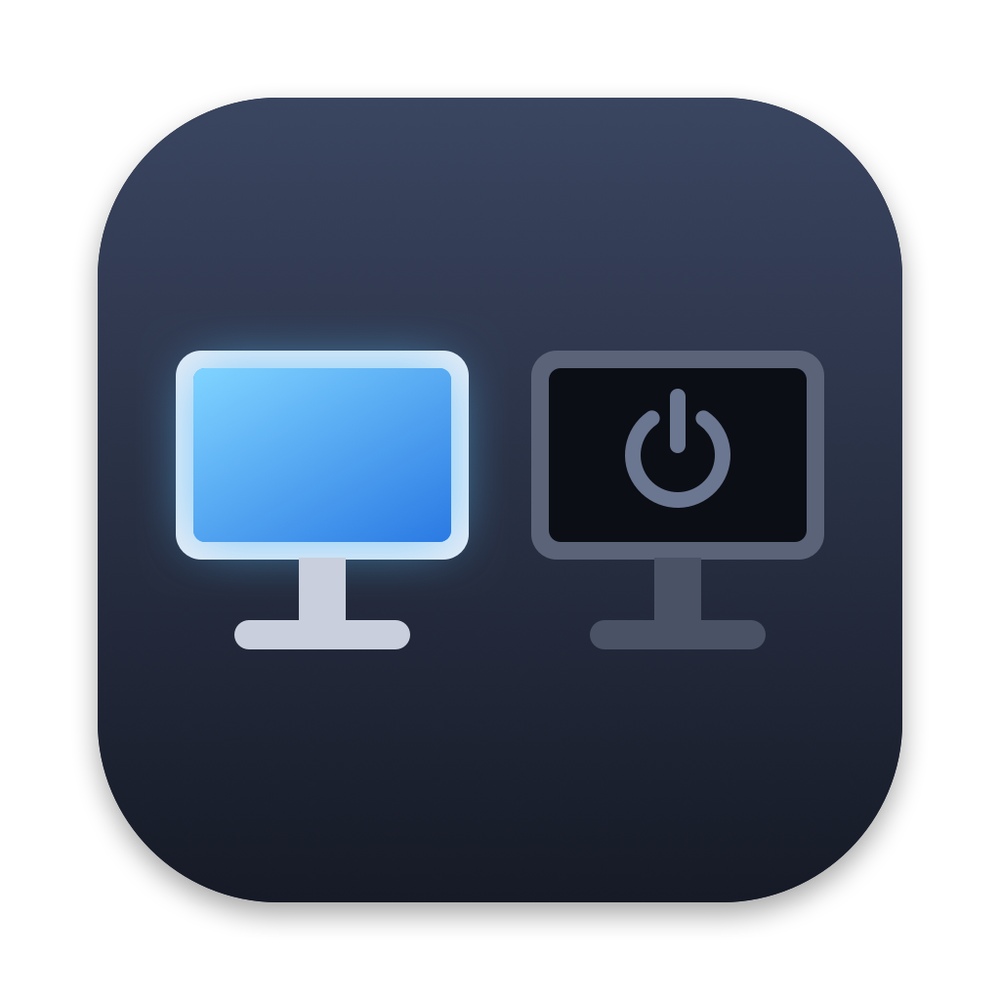

# DumbMonitors



Turn external monitors off and on from your Mac's menu bar or terminal — no unplugging, no paid apps.

"Off" means macOS treats the monitor as disconnected: windows move to your other screens and the monitor goes to standby. "On" brings it back.

## What's included

- **DumbMonitors.app** — a menu-bar icon listing your monitors. Click one to turn it off or on.
- **`monitor`** — the same thing from the terminal:

```
monitor list            # show monitors and whether they're on
monitor off acer        # turn off by brand, part of the name, or ID
monitor off             # turn off a non-main external monitor
monitor on              # turn back on everything turned off
monitor                 # toggle
```

Both share state, so you can turn a monitor off in one and back on in the other.

## Build

Requires macOS 13+ and the Xcode Command Line Tools (`xcode-select --install`).

```
./build.sh              # builds DumbMonitors.app and installs `monitor` to ~/.local/bin
./build.sh install      # also copies the app to /Applications
```

The app lives only in the menu bar (no Dock icon or window). If you don't see it, check **System Settings → Menu Bar** or make room among your menu-bar icons. Use **Open at Login** in its menu to start it automatically.

## Safety

- It will never turn off your last active screen (the CLI needs `--force` to do so).
- Nothing is changed permanently: if a monitor ever stays off, unplugging and replugging its cable brings it back.

## How it works

It calls `CGSConfigureDisplayEnabled`, a private (undocumented) CoreGraphics function — the same one paid tools use. Because it's not a public Apple API, a future macOS update could break it. Tested on macOS 27 with Apple Silicon.

## Icon

The icon is drawn in code by `Icon/make_icon.swift`. To change it, edit that file and run `swift Icon/make_icon.swift Icon/icon.png`.

## License

MIT
